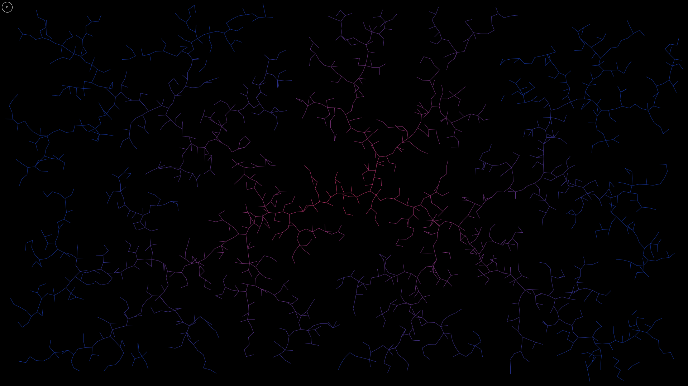
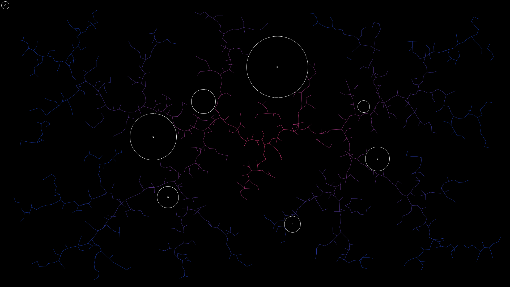

# RRT simulation

A simple rapidly exploring random tree ([RRT](https://en.wikipedia.org/wiki/Rapidly_exploring_random_tree)) simulation. 

The RRT tries to expand into areas, where it has not yet been to. 
In the demo you can create circular obstacles, which the RTT will not intersect. 
Create an obstacle by clicking once to place the center, and once to determine the radius. 

## Screenshot

This screenshot shows a colorfull rendered RRT. 

This screen shot shows an RRT expanding around obstacles.